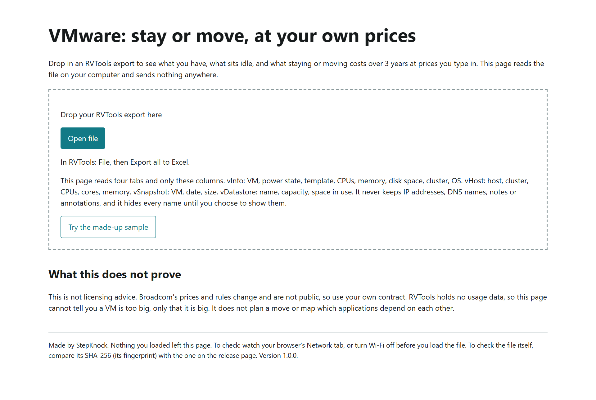
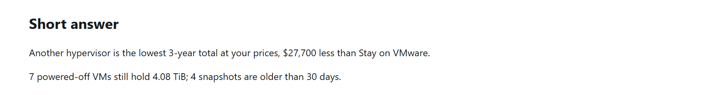
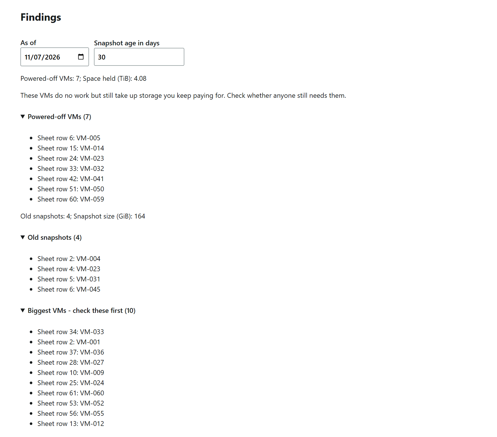
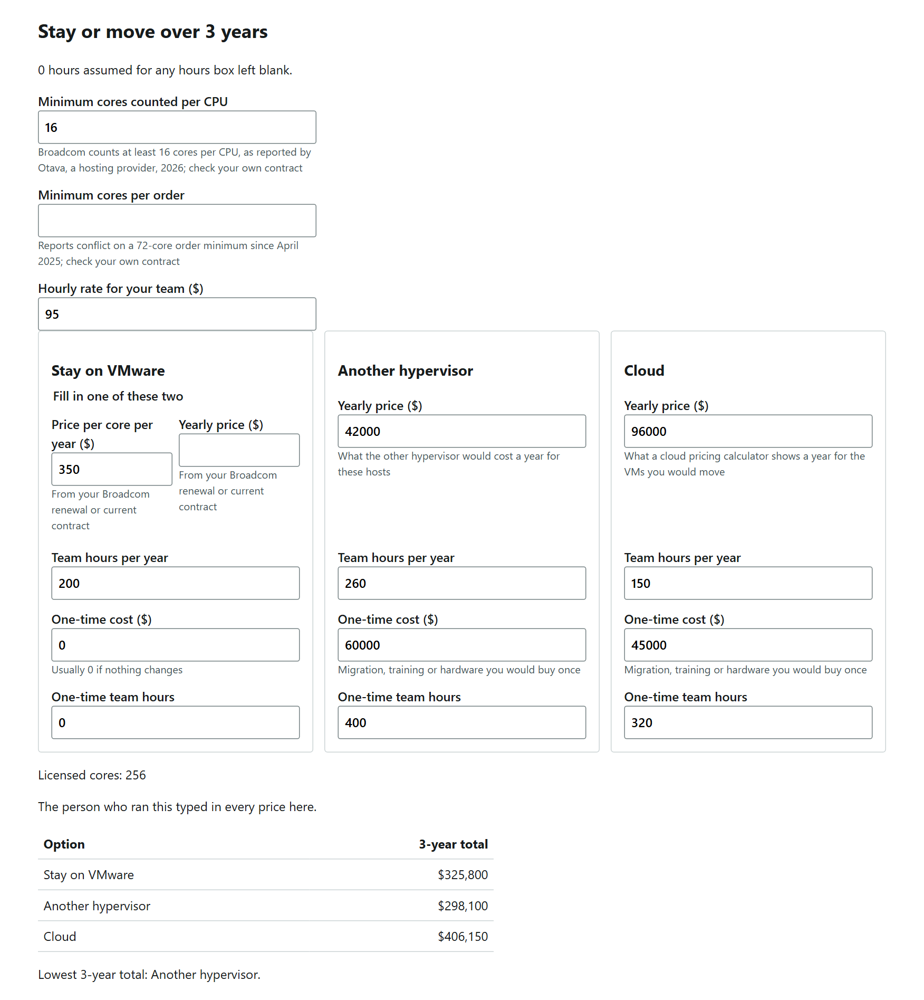
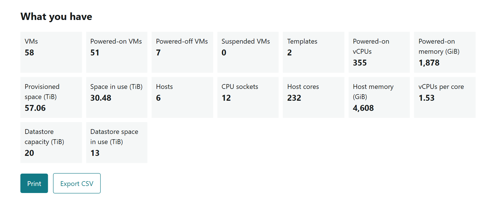

# VMware: stay or move, at your own prices

One HTML file. Download it, open it in your browser, and drop in an RVTools export (a spreadsheet listing your VMware setup). It shows what you run, what sits idle, and a 3-year comparison of staying on VMware, moving to another hypervisor (the software that runs virtual machines), or moving to cloud, at prices you type in yourself. It can tell you staying is cheapest.

Your file never leaves your computer. The page has no server behind it, makes no network requests, and stores nothing. You do not have to take our word for it: the [three checks below](#check-it-yourself) take two minutes.

## Contents

- [Who it is for](#who-it-is-for)
- [What you need](#what-you-need)
- [How to use it](#how-to-use-it)
- [How to read the results](#how-to-read-the-results)
- [Where the prices come from](#where-the-prices-come-from)
- [What it does not prove](#what-it-does-not-prove)
- [Check it yourself](#check-it-yourself)
- [For your security team](#for-your-security-team)
- [Questions and problems](#questions-and-problems)
- [The source](#the-source)
- [License](#license)

## Who it is for

- **VMware admins** who have been asked "what would it cost to leave?" and need an answer built from their own environment, not a vendor's slide.
- **IT leaders** facing a Broadcom renewal who want to see staying and moving side by side, with every number one they can defend.

Reach for it when:

- a renewal quote has arrived and you want to know what you are licensing;
- someone proposes a move to another hypervisor or to cloud and you want the 3-year total, not just the yearly price;
- you want to find powered-off VMs (virtual machines) and old snapshots before you count anything, because there is no point paying to license or move them.

It takes about ten minutes once you have the export.

## What you need

- **An RVTools export.** RVTools is a long-standing Windows program that reads your inventory from vCenter, VMware's management console, and saves it as an Excel workbook. Dell now distributes it. Get it only from the official sources Dell names: the [RVTools page on Dell's support site](https://www.dell.com/support/kbdoc/en-us/000325532), robware.net or rvtools.com.
- **A vCenter account that can read the inventory.** Read-only is enough. RVTools changes nothing in vCenter.
- **A Windows PC to run RVTools.** RVTools itself runs only on Windows. This HTML file runs anywhere, so you can export on Windows and open the result on a Mac.
- **A current browser:** Chrome, Edge or Firefox. We have not tested Safari.

You do not need an internet connection, an account or an install. Nothing to sign up for.

## How to use it

1. **Download** `vmware-stay-or-move.html` from the [latest release](https://github.com/StepKnock/vmware-stay-or-move/releases/latest). If you want to be sure it is the real file, [check its fingerprint](#check-it-yourself) first.
2. **Export from RVTools.** Connect RVTools to your vCenter, then choose File, then Export all to Excel. You get one `.xlsx` workbook.
3. **Open the HTML file** in Chrome, Edge or Firefox. Double-clicking usually works; if it opens in the wrong program, right-click it and choose Open with.
4. **Load your export.** Drop the workbook on the page, or press Open file. To look around first, press "Try the made-up sample". It loads a small invented environment.
5. **Read the short answer and the findings** at the top. See [how to read the results](#how-to-read-the-results).
6. **Type your prices** into the 3-year comparison. Every price starts blank. See [where the prices come from](#where-the-prices-come-from).
7. **Print it or export it.** Print fits on one page for a meeting. Export CSV gives you the rows behind the findings for a spreadsheet.

Reloading the page wipes everything. Nothing is saved anywhere, so print or export before you close it.

## How to read the results

The results page has four parts, top to bottom.

### Short answer

Two lines. The first says which option has the lowest 3-year total at your prices and by how much, or what is still missing before it can say. The second says how many powered-off VMs still hold storage and how many snapshots are older than the age you picked.

### Findings: what sits idle

- **Powered-off VMs** do no work but still hold storage you keep paying for. The page counts them and the space they hold. Check whether anyone still needs them.
- **Old snapshots** are saved point-in-time copies of a VM, older than the age you set (30 days to start). They keep growing and are easy to forget.
- **Biggest VMs** are the ten with the most vCPUs (virtual processors), then the most memory. Look at these first when you plan a move or a cleanup.
- **As of** is the day snapshot ages are counted from. It starts as today; if your export is older, set it to the day the export was made.
- **Sheet row** is the row number in your workbook, so you can find the VM there.
- **Names are hidden** (VM-001, HOST-001) until you press "Show real names". This lets you share a screen or a printout without showing your naming. The toggle is off every time the page loads.
- **Cells this page could not read:** the page lists any and counts them as 0, so it never guesses.

### Stay or move over 3 years

The prices in this picture are made up to show how it works. Do not use them.

- **Minimum cores counted per CPU** (16 to start). Broadcom licenses VMware by CPU core, and counts at least 16 cores for every CPU, even one with fewer. A host with two 8-core CPUs is counted as 32 cores, not 16. Change the number if your contract says something else.
- **Minimum cores per order** is blank to start. Some reports say there is a 72-core minimum per order since April 2025; others disagree. Fill it in only if your contract has one.
- **Licensed cores** is the result: the host cores from your export, raised to those minimums. This is the number your VMware price per core is multiplied by.
- **Three options,** each with its own box: stay on VMware, move to another hypervisor, move to cloud. For staying, enter either a price per core per year or a yearly price, not both.
- **Team hours** are the hours your people spend running each option each year, and the one-time hours to move. The page prices them at the hourly rate you enter. A blank hours box counts as 0, and the page says so.
- **3-year total** for each option is the yearly price times 3, plus the team hours at your rate, plus the one-time costs. The page names the lowest total, whichever it is, including staying.

### What you have

The inventory: VMs (on, off, suspended, templates), powered-on vCPUs and memory, provisioned space and space in use, hosts, CPU sockets, host cores, host memory, vCPUs per core, and datastore capacity and use. If a tab is missing from your export, the page says which numbers it could not work out.

## Where the prices come from

You type every price. The page has no price list, because Broadcom's prices are not public and change, and because the only prices that matter are the ones you would actually pay.

- **Stay on VMware:** your Broadcom renewal quote or current contract. A price per core per year is the most common form.
- **Another hypervisor:** a quote, or the vendor's published price, for the same hosts for one year.
- **Cloud:** a cloud provider's own pricing calculator, for the VMs you would move, for one year. Feed it the "What you have" numbers (vCPUs, memory, space in use).
- **One-time costs:** migration services, training, or hardware you would buy once.
- **Hourly rate:** what an hour of your team's time costs, with benefits and overhead. If you do not know, ask finance for a number and write it next to the printout.

## What it does not prove

This is not licensing advice. Broadcom's prices and rules change and are not public; use your own contract. RVTools holds no usage data, so this cannot tell you a machine is too big, only that it is big. It does not plan the move or check which applications depend on each other.

## Check it yourself

1. **Watch the network.** Open the file, press F12, open the Network tab, then load your export. Nothing goes to any internet address. The only entries you may see are the file itself and its built-in reader, which starts from a `blob:` address inside the page.
2. **Turn Wi-Fi off.** Disconnect from every network, open the file, and load your export. It works the same.
3. **Check the fingerprint.** Compare the file's SHA-256 with the one in this README and on the release page.
   - Windows (PowerShell): `Get-FileHash .\vmware-stay-or-move.html -Algorithm SHA256`
   - macOS or Linux: `shasum -a 256 vmware-stay-or-move.html`

   SHA-256 for version 1.0.0: `2841920d5e9a894935bb3eb14d87ef44e79a01b3379e323a48768b95ab6927a1`

## For your security team

- **What is read:** four tabs (vInfo, vHost, vSnapshot, vDatastore) and only the columns listed on the page. IP addresses, DNS names, notes and annotations are dropped as the file is read and never kept. VM, host and datastore names are hidden (VM-001, HOST-001) until the person running it turns them on, and the toggle is off on every load.
- **What it can reach:** nothing. A Content Security Policy in the file sets `connect-src 'none'` and `default-src 'none'`, allows only the file's own script and style by hash, and enforces Trusted Types. There are no external scripts, fonts or images.
- **What it keeps:** nothing. No cookies, local storage or IndexedDB. Reloading the page wipes everything.
- **Hostile files:** the reader refuses files over 50 MB, more than 300 MB unzipped, more than 200,000 rows, any DOCTYPE, UTF-16 parts, broken or deeply nested XML, and zip entries that share data. Reading runs in a worker that is stopped after 10 seconds. CSV export puts a `'` before any cell that starts with `=`, `+`, `-`, `@`, a tab or a carriage return.
- **Who made it and why:** StepKnock, a two-person San Diego company that works on storage, backup and recovery. We are paid through partners when a customer buys hardware or software. This file asks for nothing, has no sign-up, and costs nothing to use.

## Questions and problems

**The file will not load.**
Check that it is the `.xlsx` workbook RVTools wrote, not a copy someone opened and re-saved in another program. Files over 50 MB, or with more than 200,000 rows, are refused; export one vCenter at a time. If reading takes longer than 10 seconds, the page stops and says so.

**It says "This does not look like an RVTools export: it has no vInfo tab."**
The workbook has no vInfo tab, so it is not an RVTools export, or the tab was renamed or deleted. Export again with Export all to Excel.

**It says some tabs are missing.**
The page still works with only vInfo. Without vHost it cannot count cores, so there is no licensed-core number. Without vSnapshot there is no snapshot finding. Without vDatastore there are no datastore totals. Use Export all to Excel, not a single-tab export, to get all four.

**I have an older RVTools version.**
Older versions name the space columns in MB, newer ones in MiB. The page reads both. If a number it needs cannot be read, that cell is listed under "Cells this page could not read" and counted as 0, never guessed.

**I have the CSV export, not Excel.**
That works too. Choose the RVTools CSV files together (named like `RVTools_tabvInfo.csv`) in the Open file window.

**I am on a Mac.**
The HTML file works on a Mac in Chrome, Edge or Firefox. RVTools itself runs only on Windows, so make the export on a Windows PC and copy the `.xlsx` over.

**Why do all the prices start blank?**
Because any price we filled in would be wrong for you. Broadcom's prices are not public and differ by contract, and cloud prices depend on what you move. A blank box cannot quietly become your answer.

**Does it work offline?**
Yes. It never goes online. Turn Wi-Fi off and try it.

**Can I share the results?**
Print it or export the CSV. Names stay hidden unless you turn them on, so check the toggle before you share.

**How do I report a problem or ask for a change?**
Open an issue on [GitHub Issues](https://github.com/StepKnock/vmware-stay-or-move/issues). Never attach your real RVTools export: it describes your environment. Describe what happened, your browser and RVTools version, and the exact message the page showed. If you can, reproduce it with the made-up sample.

## The source

`source/` holds everything the HTML file is built from: the reader (`engine/engine.js`), the cost math (`engine/cost.js`), the page (`page/src/`) and the build script (`page/build.mjs`), which inlines them into one file and writes the CSP hashes. The made-up sample workbook is in `source/sample/`. Rebuild with Node 20 or later: `node source/page/build.mjs` writes `source/dist/vmware-stay-or-move.html`, which should match the fingerprint above byte for byte.

The pictures in `docs/` were taken from this file on the made-up sample.

## License

MIT. See `LICENSE`.
